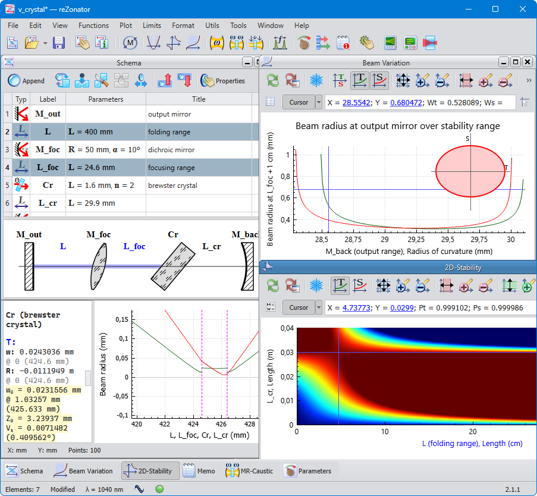

# reZonator

## 关于

[reZonator](http://rezonator.orion-project.org) 是一款功能强大的跨平台软件，用于设计激光谐振腔，并计算光束（既可按高斯光束，也可按光线矢量）在复杂光学系统中的传播——不仅适用于谐振腔，也适用于单程系统。事实已经[证明](http://rezonator.orion-project.org/?page=citation)，它对全球许多用户都很有帮助。

它由一位具有多年经验、拥有经典科学背景的专业程序员编写。最初，它是作为内部使用的工作工具开发的。所以我们清楚自己希望从这个工具中得到什么，并按使用起来顺手的方式去实现它。当然，不同人对“顺手”的理解不同，对功能的需求也不同。因此欢迎提出[建议和错误报告](https://github.com/orion-project/rezonator2/issues)，尤其是错误报告 🫣😀

## 下载

Windows、Linux 和 macOS 的二进制安装包见项目[主页](http://rezonator.orion-project.org)或 GitHub [Releases](https://github.com/orion-project/rezonator2/releases) 页面。从源码构建见[构建说明](./docs/build.md)。

**Windows：** 如果遇到缺少 DLL 文件（例如 `MSVCP140.dll`）的错误，可能需要安装 Microsoft Visual C++ 可再发行组件包。请从[Microsoft 官方页面](https://learn.microsoft.com/en-us/cpp/windows/latest-supported-vc-redist)下载最新版本。

## 开发动机

尽管已经有不少优秀的[例子](https://www.scilab.org)，如今的专业科学软件领域仍然存在一种由来已久的风气：让用户白白花钱，哪怕它们提供的功能相当通用、直截了当，而且在文献中早有充分描述。现如今，这类计算中的大多数，一个优秀的学生只用 [Python](https://www.python.org) 就能完成。Python 及其[库](https://numpy.org)极其强大，而且是[开源](https://opensource.org)的，它很好地示范了现代世界中软件开发——甚至包括商业软件开发——的发展方向。与商业科学软件不同，它开放内部实现，鼓励用户学习和改进，并且[几乎](https://en.wikipedia.org/wiki/GNU_General_Public_License)不要求任何回报。本项目遵循同样的开源原则，试图把哪怕一点点同等程度的开放带到“科学”软件的世界里。它只是为你提供常规的、众所周知的[方法](https://en.wikipedia.org/wiki/Ray_transfer_matrix_analysis)，并把它们封装进一个方便易用的界面，而不是假装自己实现了某种“专利”算法，宣称“只有我们知道怎么做，而且我们会保密”。任何人都可以查看源码，检查其正确性，实现自己的函数，或改进现有的函数。它并不打算提供那些收费“巨无霸”软件的全部功能，而是希望提供足够的功能，切实帮上忙、派上用场。

## 功能特点

- **光学系统：** reZonator 支持不同的[光学系统类型](http://rezonator.orion-project.org/help/trip_type.html)——驻波激光腔和行波（环形）谐振腔，以及常规的单程系统，例如泵浦光路或扩束系统。对于单程系统，还会考虑 M² 光束质量因子。

- **光学元件：** 程序的[元件目录](http://rezonator.orion-project.org/help/elements.html)包含许多基本的光学元件——间隔、透镜、反射镜、晶体等等。光学元件的模拟采用 ABCD 光线矩阵算法，因此你也可以通过给出矩阵来定义自己的元件。

- :new: :fire: 使用**自定义元件**，你可以给出由元件参数[计算矩阵](http://rezonator.orion-project.org/help/matrix/ElemFormula.html)的公式，创建标准库中没有的、属于你自己的光学元件。

- :new: :fire: **自定义参数**允许你在元件的标准内置参数之外，为其扩展额外的[用户定义参数](http://rezonator.orion-project.org/help/custom_params.html)。当你需要跟踪或计算与你的光学系统相关的额外属性时，这非常有用。

- **不受限制的设计：** 本应用并不计算某种特定的光学几何结构。相反，你可以用所提供的或用户定义的光学元件构建任意光学系统。reZonator 会自动创建所研究系统的[布局图](http://rezonator.orion-project.org/help/layout.html)——几乎就像你在一张纸或绘图板上把它画出来一样。

- **稳定性图：** 为进行高级系统优化，reZonator 可以计算腔的稳定性图随任意元件的[一个](http://rezonator.orion-project.org/help/func_stabmap.html)或[两个](http://rezonator.orion-project.org/help/func_stabmap_2d.html)参数的变化情况，还提供稳定性边界的自动计算。

- **波前计算：** reZonator 可以绘制高斯光束在[一个](http://rezonator.orion-project.org/help/func_caustic.html)或[多个](http://rezonator.orion-project.org/help/func_caustic_mr.html)元件上的光斑大小和波前曲率半径，并考虑像散。可以计算系统内任意位置处的光束大小。还提供以下功能：自动确定束腰所在元件处束腰的位置和大小、计算衍射发散半径，以及[高斯光束](http://rezonator.orion-project.org/help/calc_gauss.html)的其他参数。

- :new: :fire: **自定义函数**提供了一种强大的方式来扩展 reZonator 的能力：你可以编写自己的 Python 代码来分析光学系统、执行专门的计算，并以适合你具体需求的方式可视化结果。

- **微调：** [调节](http://rezonator.orion-project.org/help/adjust.html)工具允许你逐步改变任意元件的任意参数——就像你转动某个反射镜架或平移台的螺丝一样。在参数值改变的同时，所有结果都会即时重新计算。

- **参数化设计：** [全局参数](http://rezonator.orion-project.org/help/params_window.html)可以把不同的元件相互关联；由自定义公式给出的参数值使你能够构建动态的、参数化的系统。

- **更多功能：** 还提供其他方便实用的工具和功能：[重复频率](http://rezonator.orion-project.org/help/func_reprate.html)、所有元件处的[光束参数](http://rezonator.orion-project.org/help/func_beamdata.html)、元件失调（通过自定义脚本）、[“冻结”](http://rezonator.orion-project.org/help/func_freeze.html)结果、完整的绘图格式自定义、将结果复制到剪贴板，等等……

##

##

